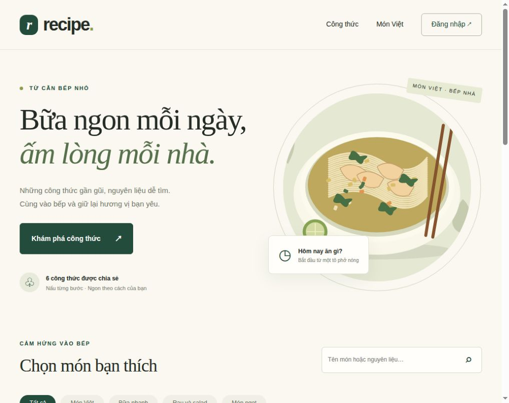

# Đề 29 Website Công thức Nấu ăn Recipe

Ứng dụng PHP và MySQL chia sẻ món ăn, nguyên liệu, các bước nấu và danh mục. Quản trị viên có thể thêm, sửa, lưu trữ và khôi phục công thức. Dự án triển khai bằng Docker Compose trên Ubuntu; khung thư mục tham khảo repo [Đề 7 Blog CMS](https://github.com/Khanhslee/DTC245220024_De7-Blog-CMS).

Mã sinh viên: **DTC245220017**. Phần bìa báo cáo do sinh viên bổ sung.

## Khởi chạy

Cần Docker Engine, Docker Compose v2, Git và Python 3.

```bash
git clone https://github.com/longphan632000/DTC245220017_De29-Recipe.git
cd DTC245220017_De29-Recipe
python3 scripts/setup.py
```

Script tạo `.env` với mật khẩu ngẫu nhiên, build ứng dụng, tạo schema và tài khoản quản trị. Nếu đã có `.env`, script giữ các giá trị đã cấu hình. Không sao chép nguyên mật khẩu mẫu từ `.env.example`.

## Dịch vụ

| Dịch vụ | Địa chỉ |
| --- | --- |
| Website qua Nginx | http://127.0.0.1:8088 |
| Quản trị Recipe | http://127.0.0.1:8088/?page=login |
| phpMyAdmin qua Nginx | http://127.0.0.1:8081 |
| MySQL | Mạng nội bộ `db_net`, không publish cổng |
| Grafana | http://127.0.0.1:3000 |
| Prometheus | http://127.0.0.1:9090 |
| Loki API | http://127.0.0.1:3100/ready |

Tài khoản ứng dụng dùng `APP_ADMIN_USER`, `APP_ADMIN_PASSWORD`. phpMyAdmin dùng `MYSQL_USER`, `MYSQL_PASSWORD`. Tất cả bí mật chỉ lưu trong `.env`, quyền `600`, không commit lên GitHub.

## Cấu trúc

`app/src` chứa mã nguồn PHP, `mysql/init.sql` chứa schema và dữ liệu mẫu, `nginx/nginx.conf` cấu hình reverse proxy và security headers. `docker-compose.yml` quản lý các dịch vụ và volume dữ liệu.

## Bảo mật

Ứng dụng, MySQL, phpMyAdmin và Nginx chạy bằng UID không phải root. Container bỏ toàn bộ Linux capabilities, bật `no-new-privileges`, đặt filesystem gốc chỉ đọc. Database dùng mạng nội bộ và tài khoản ứng dụng chỉ có quyền DML. Mật khẩu đăng nhập được băm; POST có CSRF token và truy vấn DB có tham số. Nginx thêm security headers và hạn chế tần suất đăng nhập.

## Dừng hệ thống

```bash
docker compose stop
docker compose up -d
```

Không dùng `down -v` khi cần giữ dữ liệu.

## Giám sát

Prometheus scrape mỗi 15 giây từ cAdvisor, Nginx Exporter và MySQL Exporter. Grafana tự nhận datasource và dashboard **Recipe — Containers • Nginx • MySQL**, có CPU/RAM/mạng theo container, yêu cầu và kết nối Nginx, trạng thái và truy vấn MySQL. Đăng nhập bằng `GRAFANA_ADMIN_USER`, `GRAFANA_ADMIN_PASSWORD` trong `.env`.

```promql
up
mysql_up
nginx_up
sum by (container_label_com_docker_compose_service) (rate(container_cpu_usage_seconds_total{container_label_com_docker_compose_project="recipe"}[2m])) * 100
```

cAdvisor là ngoại lệ chạy root để đọc cgroups và metadata Docker/containerd. Các mount host đặt chỉ đọc, không bật privileged và không publish cổng cAdvisor. Socket Unix gắn `:ro` vẫn có khả năng gọi API runtime; chỉ sử dụng collector đáng tin cậy trên máy lab. Database, ứng dụng và các dịch vụ thông thường chạy non-root.

## Log tập trung

Promtail đọc named volume log của Nginx, ứng dụng PHP và MySQL rồi gửi về Loki. Không cấp Docker socket cho Promtail. Vị trí đọc được lưu trong volume riêng; Loki dùng TSDB và filesystem, giữ log 7 ngày. Grafana tự nhận datasource Loki và dashboard **Recipe — Logs và LogQL**.

```logql
{job="nginx"}
{job="nginx"} | json | status >= 400
{job="app"} |= "login_success"
```

Hướng dẫn và truy vấn bổ sung: [docs/LOGQL.md](docs/LOGQL.md). Biện pháp bảo mật, cách kiểm chứng và giới hạn của bản lab: [docs/HARDENING.md](docs/HARDENING.md).

## Kiểm chứng

```bash
docker compose config --quiet
docker compose ps -a
python3 scripts/verify.py
```

Script kiểm tra HTTP, tìm kiếm, danh mục, CRUD, phpMyAdmin, CSRF, SQL injection, XSS, quyền DB, metrics, Grafana, LogQL và cấu hình runtime. Script tạo một công thức tạm rồi xóa đúng bản ghi thử trong `finally`. Kết quả JSON/văn bản ở `minh-chung/verification.*`; không ghi bí mật vào báo cáo. Chạy kiểm tra trên máy Ubuntu này hoặc môi trường Linux có Docker/containerd socket như cấu hình.

## Sao lưu và vận hành

```bash
python3 scripts/backup.py
docker compose logs --tail=50 app nginx
docker compose restart app nginx
```

Bản sao lưu đặt tại `runtime/backups/`, quyền 600 và không vào Git. Khôi phục là thao tác ghi đè dữ liệu; chỉ thực hiện sau khi chọn đúng bản sao lưu và đã sao lưu hiện trạng:

```bash
gzip -dc runtime/backups/recipe-THOI_DIEM.sql.gz | docker compose exec -T db sh -c 'MYSQL_PWD="$MYSQL_ROOT_PASSWORD" mysql --default-character-set=utf8mb4 -uroot "$MYSQL_DATABASE"'
```

Các UI chỉ bind localhost. Nếu demo từ máy khác, dùng SSH tunnel đến Ubuntu thay vì mở toàn bộ cổng database và dashboard. Ví dụ tunnel website: `ssh -L 8088:127.0.0.1:8088 longphan@DIA_CHI_UBUNTU`.

## Theo dõi các tiêu chí

| Tiêu chí đề bài | Thành phần |
| --- | --- |
| GitHub và README | Repository này, lịch sử commit theo 3 giai đoạn |
| Ứng dụng và DB | `app/src`, `mysql/init.sql`, phpMyAdmin |
| Reverse proxy | `nginx/nginx.conf`, security headers |
| Monitoring | `prometheus/`, `grafana/`, 3 exporter |
| Logging và LogQL | `loki/`, `promtail/`, dashboard log và 4 truy vấn kiểm chứng |
| Hardening | `docker-compose.yml`, `docs/HARDENING.md`, kết quả runtime |
| Báo cáo và demo | `docs/`, `minh-chung/`; bìa do sinh viên tự bổ sung |

## Báo cáo và minh chứng

- [Báo cáo Word 45 trang](docs/Bao_cao_De29_Recipe.docx) và [bản PDF](docs/Bao_cao_De29_Recipe.pdf); bổ sung bìa trước khi nộp.
- Bản mở rộng có **52 hình**, hướng dẫn triển khai và thao tác website theo từng bước, trích cấu hình thực tế, giải thích PromQL/LogQL, kiểm chứng hardening và xử lý sự cố.
- [Hướng dẫn bàn giao và demo](docs/BAN_GIAO.md).
- [Minh chứng chi tiết và nguồn output lệnh](minh-chung/chi-tiet/README.md): ảnh UI thật, TXT/JSON nguồn và sơ đồ kỹ thuật. Mỗi hình CLI được ghi rõ là bản trình bày output lệnh thực tế.
- [Ảnh giao diện và dữ liệu kiểm chứng](minh-chung/): 51/51 kiểm tra tích hợp đạt; 8/8 kiểm tra cài mới từ GitHub đạt.



## Khung tham khảo

Cách chia thư mục và các lớp dịch vụ tham khảo [Khanhslee/DTC245220024_De7-Blog-CMS](https://github.com/Khanhslee/DTC245220024_De7-Blog-CMS). Mã ứng dụng Recipe, dữ liệu, cấu hình provisioning, kiểm thử và báo cáo được xây dựng cho Đề 29. Chứng chỉ/private key và mật khẩu từ repo tham khảo không được sử dụng.
